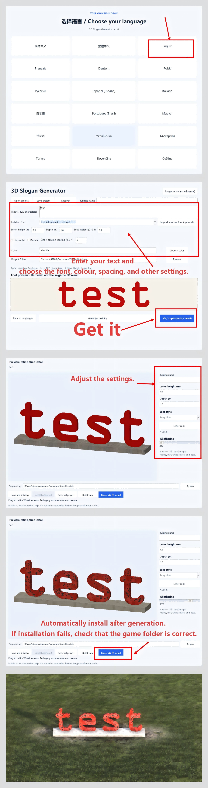
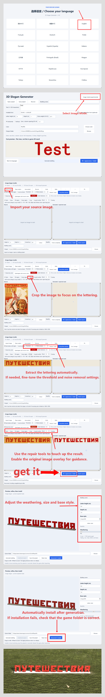

# Build Your Own Giant Slogans — v1.0

[简体中文](README.zh-CN.md)

Create fixed 3D slogan buildings from your own text, installed fonts or images.

## Steam Workshop

Subscribe to [your own big slogan on Steam Workshop](https://steamcommunity.com/sharedfiles/filedetails/?id=3837972328) for 18 ready-made red 3D slogan buildings. The generator is not required to use these buildings; download it from Releases below to create your own text, fonts, sizes and colours.

## Download

Download the Windows x64 portable ZIP from [Releases](https://github.com/skwastid/slogan-Mod-for-Workers-Resources-Soviet-Republic/releases), extract the entire archive, and run `SloganGenerator.exe`. Python is not required. Keep the `_internal` folder next to the executable.

Choose a language, then use text mode or image mode. Open **3D / appearance / install** to preview the model, choose a base and weathering, then generate and install it into your game. Restart the game to load new buildings. You can also copy an exported numeric folder manually to `media_soviet/workshop_wip`.

## Version 1.0 features

- **Text:** installed-font discovery, optional TTF/OTF/TTC import, multiline and upright vertical text, adjustable spacing, size, depth, weight, colour and building names.
- **Images:** cropping, four-point perspective correction, threshold or colour extraction, eyedropper, noise removal, paint/erase tools and source overlay.
- **Layout:** cut lettering into movable pieces; rotate, scale, multiselect, align and distribute with equal gaps.
- **Appearance:** live 3D preview, long plinth/no base/slogan wall, weathering and rendered building thumbnails.
- **Projects:** full project saving, autosave and recovery, including editable pieces and appearance settings. Only the current 1.0 project format is supported.
- **Installation:** generate and install into local `workshop_wip`; verify copied files and never overwrite existing buildings.
- **Languages:** all 18 interface languages across text, image, layout and 3D windows. OS dialogs follow Windows language settings; technical library diagnostics may remain in their original language.

Portable download: approximately **48 MB**, extracted application approximately **105 MB**. See the [1.0 guide](V1_GUIDE.md) and [release notes](RELEASE_NOTES_v1.0.md).

Text is fixed geometry, not editable with the game's T_ tool. Image extraction preserves visible outlines rather than recognizing or reconstructing a font; manual repair may be needed. Preview lighting differs from the game. TTC uses its first font. Complex script shaping, arbitrary combining marks and colour emoji are not supported. Character coverage depends on the selected font. Text is limited to 120 characters / 12 lines and the model vertex limit.

## Illustrated tutorials

### Create a slogan from text

Choose a language, enter your text, select a font and adjust the settings. Open the 3D preview to refine the appearance, then generate and install. If installation fails, check the game folder. Click the image to view it at full size.

[](docs/tutorials/text-mode-en.png)

### Create a slogan from an image

Select Image Mode, import your source image and crop the lettering. Extract it, adjust the threshold and noise removal if needed, then repair the strokes with the source overlay. Preview the model, choose its size, base and weathering, then generate and install.

[](docs/tutorials/image-mode-en.png)

## Development

Windows x64, Python 3.11+ with tkinter, and an installed copy of the game are required.

```powershell
python -m venv .venv
.\.venv\Scripts\Activate.ps1
python -m pip install -r requirements.txt
python tools/import_game_assets.py "D:\SteamLibrary\steamapps\common\SovietRepublic"
python app.py
```

Replace the example game path. Game textures are imported locally and ignored by Git.

```powershell
python -m pip install -r requirements-build.txt
.\build.ps1
```

Output: `dist/SloganGenerator-v1.0-windows-x64.zip`. Use a clean virtual environment; the build enforces an extracted application below 400 MB. The tested dependency set is recorded in `requirements-v1.0-lock.txt`.

Run checks with `python -m unittest discover -s tests -v`. The packaged EXE also supports `--localization-self-test report.json` and `--studio-self-test test-output`.

## Workshop and licensing

Generated project IDs are local placeholders. Create a real Workshop item through the game before uploading; preserve its ITEM_ID and OWNER_ID. The generator never uploads automatically.

No system fonts are bundled. Check the font license before publicly distributing generated glyph models. See [third-party notices](THIRD_PARTY_NOTICES.md). A project-wide open-source license has not yet been selected.

## Credits

Created by skwastid, with assistance from GPT-6 Astra.
