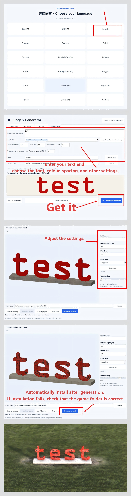
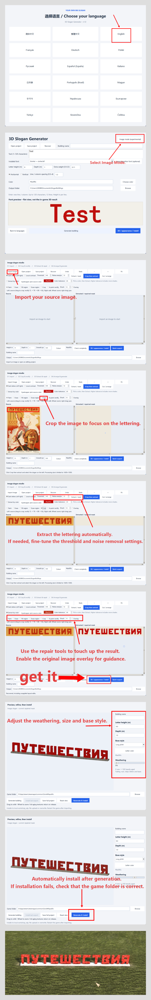

# [⬇ Download Generator v1.0.1 — Releases](https://github.com/skwastid/slogan-Mod-for-Workers-Resources-Soviet-Republic/releases/tag/v1.0.1)

**Download `SloganGenerator-v1.0.1-windows-x64.zip`, extract the entire archive, and run `SloganGenerator.exe`. No Python required; keep the `_internal` folder beside the EXE.**

[简体中文](README.zh-CN.md)

## Illustrated tutorials

### Create a slogan from text

Choose a language, enter your text, select a font and adjust the settings. Open the 3D preview to refine the appearance, then generate and install. If installation fails, check the game folder. Click the image to view it at full size.

[](docs/tutorials/text-mode-en.png)

### Create a slogan from an image

Select Image Mode, import your source image and crop the lettering. Extract it, adjust the threshold and noise removal if needed, then repair the strokes with the source overlay. Preview the model, choose its size, base and weathering, then generate and install.

[](docs/tutorials/image-mode-en.png)

---

# Build Your Own Giant Slogans — v1.0.1

Create fixed 3D slogan buildings from your own text, installed fonts or images.

## v1.0.1

- **add**: Added stone signs with independent top/bottom widths, top/bottom thicknesses and stone height, with flush lettering that follows the face. Added optional iron frames with evenly spaced posts, rails, rear braces and rust. Added base dimensions, colours, wall thickness and a road size reference. Chinese interfaces now offer Chinese font names, search and filtering. New controls support all 18 interface languages.
- **fix**: Fixed mirrored exports, wall model placement and preview rotation centres, and incorrect text-preview arguments.
- **perf**: Cached preview geometry and textures and improved continuous dragging. Simplified shading is used during rotation; full textures return on release.
- **change**: Compared with 1.0, appearance controls now use a scrollable panel. Project saving, model exports and thumbnails support the new base, frame and stone-sign settings.

Previously generated buildings must be regenerated and installed again to receive these changes.

## Steam Workshop

Subscribe to [your own big slogan on Steam Workshop](https://steamcommunity.com/sharedfiles/filedetails/?id=3837972328) for 18 ready-made red 3D slogan buildings. The generator is not required to use these buildings; download it from Releases below to create your own text, fonts, sizes and colours.

## Download

Download the Windows x64 portable ZIP from [Releases](https://github.com/skwastid/slogan-Mod-for-Workers-Resources-Soviet-Republic/releases), extract the entire archive, and run `SloganGenerator.exe`. Python is not required. Keep the `_internal` folder next to the executable.

Choose a language, then use text mode or image mode. Open **3D / appearance / install** to preview the model, choose a base and weathering, then generate and install it into your game. Restart the game to load new buildings. You can also copy an exported numeric folder manually to `media_soviet/workshop_wip`.

## Version 1.0 features

- **Text:** installed-font discovery, optional TTF/OTF/TTC import, multiline and upright vertical text, adjustable spacing, size, depth, weight, colour and building names.
- **Images:** cropping, four-point perspective correction, threshold or colour extraction, eyedropper, noise removal, paint/erase tools and source overlay.
- **Layout:** cut lettering into movable pieces; rotate, scale, multiselect, align and distribute with equal gaps.
- **Appearance:** live 3D preview, long plinth/no base/slogan wall, weathering and rendered building thumbnails.
- **Projects:** full project saving, autosave and recovery, including editable pieces and appearance settings. Only the current 1.0 project format is supported.
- **Installation:** generate and install into local `workshop_wip`; verify copied files and never overwrite existing buildings.
- **Languages:** all 18 interface languages across text, image, layout and 3D windows. OS dialogs follow Windows language settings; technical library diagnostics may remain in their original language.

Portable download: approximately **52 MB**, extracted application approximately **108 MB**. See the usage details below and the [release notes](https://github.com/skwastid/slogan-Mod-for-Workers-Resources-Soviet-Republic/releases/tag/v1.0.1).

Text is fixed geometry, not editable with the game's T_ tool. Image extraction preserves visible outlines rather than recognizing or reconstructing a font; manual repair may be needed. Preview lighting differs from the game. TTC uses its first font. Complex script shaping, arbitrary combining marks and colour emoji are not supported. Character coverage depends on the selected font. Text is limited to 120 characters / 12 lines and the model vertex limit.

## Development

Windows x64, Python 3.11+ with tkinter, and an installed copy of the game are required.

```powershell
python -m venv .venv
.\.venv\Scripts\Activate.ps1
python -m pip install -r requirements.txt
python tools/import_game_assets.py "D:\SteamLibrary\steamapps\common\SovietRepublic"
python app.py
```

Replace the example game path. Game textures are imported locally and ignored by Git.

```powershell
python -m pip install -r requirements-build.txt
.\build.ps1
```

Output: `dist/SloganGenerator-v1.0.1-windows-x64.zip`. Use a clean virtual environment; the build enforces an extracted application below 400 MB. The tested dependency set is recorded in `requirements-v1.0-lock.txt`.

Run checks with `python -m unittest discover -s tests -v`. The packaged EXE also supports `--localization-self-test report.json` and `--studio-self-test test-output`.

## Workshop and licensing

Generated project IDs are local placeholders. Create a real Workshop item through the game before uploading; preserve its ITEM_ID and OWNER_ID. The generator never uploads automatically.

No system fonts are bundled. Check the font license before publicly distributing generated glyph models. See the third-party notices below. A project-wide open-source license has not yet been selected.

## Credits

Created by skwastid, with assistance from GPT-6 Astra.

## Usage details

Use **3D / appearance / install** from either the font screen or the image editor. The window captures the current text or repaired mask. Change letter height, depth, colour, weathering and base style there; these settings are used by its export buttons. Quick export reuses the latest appearance settings.

- **Colour extraction:** click Eyedropper, then a solid pixel inside a letter in the left image. Set Color tolerance and click Extract. Higher tolerance includes more RGB shades. This also works with Crop then extract. It is colour segmentation, not OCR: matching background colours can remain. Save projects to preserve selected colour and tolerance.
- **Brush cursor:** the repair canvas displays a ring at the brush's actual image-space size. Blue fills; red erases. The ring follows zoom and does not alter the image or export.
- **3D preview:** drag to orbit; wheel to zoom. Geometry, UV coordinates and aging textures come from the export pipeline. The simplified renderer has no game shadows or specular lighting. While dragging it uses flat materials; releasing restores full textures. Very complex silhouettes take longer to rebuild.
- **Weathering:** 0–100 controls fading, rust, paint chips and base dirt. It changes texture and material reflectivity, not mesh topology. The seed is fixed, so preview and export are reproducible.
- **Bases:** long plinth, no base, or a wall behind the text. Disconnected strokes and letters above the lowest baseline can remain unsupported; choose a wall when appropriate.
- **Install:** detect or browse to the SovietRepublic game root, then Generate & install. Alternatively export first and Install last export. The destination is `media_soviet/workshop_wip/<local ID>`. Generated project files are hash-verified; existing folders are never overwritten. No Steam login or upload is performed. Restart the game to load the new building. If copying fails, the exported building remains available to retry installation.

All generator windows support the same 18 interface languages, selected on the opening screen. Operating-system dialogs follow Windows language settings; raw technical diagnostics may retain library wording. Full projects preserve repaired pixels, extraction settings, movable character layers, appearance and camera settings. Only the current 1.0 project format is supported. Exported `generation.json` records appearance values.

Build in a clean virtual environment using pip wheels instead of the Conda/MKL stack. The build script enforces an extracted portable folder below 400,000,000 bytes. Generated buildings and images are separate user output and are not included in that budget.

### Base and preview controls

- Stone sign: a trapezoidal stone with flat lettering on its front face. Set bottom/top widths, bottom/top thicknesses and stone height; a top thickness of 0 matches the bottom thickness. Lettering follows the sloping face; equal top/bottom widths make straight sides. A top width of 0 uses 90% of the bottom width; text fits proportionally inside the face. Uses a granite-like material, optional base colour and weathering. Letter extrusion and steel supports do not apply to this style.

- Set base length, front-to-back depth, plinth height, wall height and wall thickness in metres; 0 uses the automatic size. Wall dimensions apply only to slogan walls. Wall models and preview rotation are centred on the wall, not the lettering.
- Choose a custom base colour or restore the default concrete material. Weathering applies to either finish.
- Optional regular back frames use evenly spaced posts, three horizontal rails, rear diagonal braces and foot plates. Automatic plinth depth expands to fit the braces. Supports use independent dark grey iron, with rust controlled by the weathering slider.
- The 7 m wide road reference is preview-only. Camera dragging uses cached geometry and simplified shading; detailed textures return on release.
- Dimensions, base colour and support choices are saved in full projects and used in exports and thumbnails.

### Projects and layout

- Save/Open `.sloganproj` from the font screen, image editor, or the Save button inside 3D/layout windows. Projects include original/working images, repaired pixels, individual letter blocks (including unapplied arrangements), typography, building name, output folder, appearance and camera. Fonts are referenced by local path and are not embedded. Select an installed font if reopening on another PC. Undo history is session-local.
- Changes are autosaved after approximately one second of inactivity to `%LOCALAPPDATA%/YourOwnBigSlogan/Recovery`. Font and image projects have separate checkpoints and a previous valid checkpoint. Use Recover to restore; the font screen also offers recovery on entry. Files use atomic replacement. Explicit saves remain independent of recovery files.
- In the lower layout view, Ctrl-click to toggle selection, drag empty space for a selection rectangle, or use the multi-select list. Drag a selected letter to move the group. Align left/right/top/bottom/centers or distribute equal horizontal/vertical edge-to-edge gaps. Scale and angle controls adjust the primary selected letter. Applied layouts retain editable blocks; later pixel painting merges them, with Undo available.
- Enter separates centered horizontal lines, or right-to-left columns in upright vertical mode. Letter height is per line; line/column spacing is adjustable from 0.5 to 4. Up to 120 characters and 12 lines, subject to the model vertex limit. Vertical characters remain upright; this is not language-specific vertical punctuation shaping.
- Building names accept up to 80 characters; quotes, backslashes and control characters are not allowed. An empty name uses an automatic name.
- Export thumbnails render the actual mesh, base, colour and weathering at a fixed camera angle, rather than drawing flat text. The 3D viewer camera is saved in the project but does not change the standard export-thumbnail angle.

## Third-party notices

- Python dependencies retain their respective licenses: NumPy, Pillow, Matplotlib, Shapely/GEOS, FontTools, Tk/Tcl and their dependencies. PyInstaller uses its own license and bootloader exception.
- `assets/*.dds` are game-owned textures imported from a locally installed copy of Workers & Resources: Soviet Republic. They are excluded from this Git repository. They are not relicensed by this project.
- `assets/template.nmf` is the project's small base-mesh template. The exporter reuses its static NMF node header to maintain game compatibility; generated geometry replaces the template geometry.
- No system font files are distributed. Generated models contain glyph outlines; public distribution of those models must comply with the selected font's license.
- A project-wide open-source license has not yet been selected. Public availability alone does not grant unrestricted redistribution rights.
