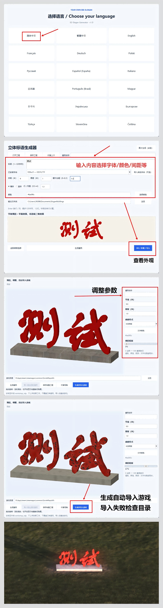
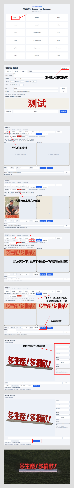

# [⬇ 下载生成器 v1.0 — Releases](https://github.com/skwastid/slogan-Mod-for-Workers-Resources-Soviet-Republic/releases/tag/v1.0)

**下载 `SloganGenerator-v1.0-windows-x64.zip`，完整解压后运行 `SloganGenerator.exe`。无需安装 Python；请保留 `_internal` 文件夹。**

[English](README.md)

## 图文使用教程

### 文字生成标语建筑

选择语言，输入内容并选择字体、颜色、间距等参数。进入3D预览调整外观，然后生成并导入游戏；导入失败时请检查游戏目录。点击图片可查看原图。

[](docs/tutorials/text-mode-zh-CN.png)

### 图片生成标语建筑

选择图片生成模式，导入素材并裁剪主要文字区域。自动提取后可微调阈值和去杂强度，叠加原图修补笔画；最后预览模型，调整大小、底座与做旧，再生成并导入游戏。

[](docs/tutorials/image-mode-zh-CN.png)

---

# 制作你的大标语 — v1.0

把电脑里的字体变成《工人与资源：苏维埃共和国》可放置的立体标语建筑。

## Steam 创意工坊

订阅 [your own big slogan 创意工坊建筑包](https://steamcommunity.com/sharedfiles/filedetails/?id=3837972328)，即可使用 18 款预制红色立体标语建筑，无需运行生成器。若要自定义文字、字体、尺寸和颜色，请从下方 Releases 下载生成器。

## 下载与安装

从 [Releases](https://github.com/skwastid/slogan-Mod-for-Workers-Resources-Soviet-Republic/releases) 下载 Windows 64 位便携版 ZIP，完整解压后双击 `SloganGenerator.exe`。不需要安装 Python；请保留旁边的 `_internal` 文件夹。

启动后先选择界面语言，再进入生成界面。默认读取本机已安装字体，也可以选择 TTF / OTF / TTC 文件。输入文字、调整字高、厚度、颜色和额外加粗，实时预览字形后生成建筑。

可通过“3D / 外观 / 导入”一键安装，或把生成的数字文件夹复制到游戏 `media_soviet/workshop_wip`，重启游戏后加载建筑。生成结果是固定立体模型，不能用游戏内的 T_ 按钮修改。

## 1.0 功能

- 文字生成、图片修补、字块重排和3D窗口统一支持18种界面语言。
- 读取电脑已安装字体，无需导入字体包。
- 最多120字符、12行，支持多行及竖排文字和行/列距。
- 字高 1–30 米、厚度 0.1–5 米、颜色和额外加粗可调。
- 图片裁剪、四点透视校正、颜色／阈值提取、吸管与手动修补。
- 字块多选、拖动、旋转、缩放、对齐与等间距排列。
- 实时3D预览、多种底座、可调做旧和模型渲染缩略图。
- 完整工程保存、自动恢复、自定义建筑名称和一键导入游戏。
- 缺字检查、模型顶点数量限制检查，不覆盖既有生成项目。

语言：简体中文、繁体中文、英语、法语、德语、波兰语、俄语、西班牙语、意大利语、日语、巴西葡萄牙语、匈牙利语、韩语、乌克兰语、保加利亚语、土耳其语、斯洛伐克语、捷克语。

## 源码运行（开发者）

需要 Windows 64 位、Python 3.11+（含 tkinter）及已安装的游戏。

```powershell
python -m venv .venv
.\.venv\Scripts\Activate.ps1
python -m pip install -r requirements.txt
python tools/import_game_assets.py "D:\SteamLibrary\steamapps\common\SovietRepublic"
python app.py
```

请把示例游戏路径改成自己的路径。游戏材质从本地安装目录导入，不存入 Git；工具不需要管理员权限。

## 构建便携版

在以上环境中运行：

```powershell
python -m pip install -r requirements-build.txt
.\build.ps1
```

产物：`dist/SloganGenerator-v1.0-windows-x64.zip`。使用干净的虚拟环境构建；构建脚本限制解压体积不超过400MB。测试依赖见 `requirements-v1.0-lock.txt`。当前便携版下载约48MB，解压约105MB。

可用的冒烟检查：

```powershell
python app.py --self-test test-output
python app.py --ui-test test-output-ui.json
```

## 使用限制

TTC 只使用第一个字体；没有复杂文字塑形、任意组合附加符号或彩色 Emoji 支持。语言支持依赖所选字体的字形覆盖。过长或复杂文字可能超过模型顶点上限。

每次生成独立的本地占位编号。发布到 Steam Workshop 时必须通过游戏创建真实项目，并保留真实 ITEM_ID / OWNER_ID；不能直接上传占位编号。生成器不会自动上传 Steam。

## 素材与许可

不打包玩家字体文件。公开分发字形模型时，请核对字体许可。游戏素材与 Python 依赖的说明见 下方第三方材料说明。本项目暂未指定开源许可证。

## 制作说明

由 GPT-6 Astra 协助制作。


**1.0** 版加入完整工程与恢复、多选对齐和等间距、自定义建筑名称、多行/竖排、渲染缩略图及3D外观和本地导入。详见下方使用说明。只支持当前工程格式。

## 使用说明

字体界面和图片编辑器均有“3D / 外观 / 导入”入口。它读取当前文字或修补结果；进入后调整字高、厚度、颜色、底座和做旧，窗口中的生成按钮会使用这些参数。主界面“快速生成”沿用最近调整的外观参数。

1. **吸管选色**：点吸管，再点击左侧文字内部颜色；调整容差后点自动提取。也可先取色再“裁剪后提取”。背景中同色物体仍可能被选中，需要修补。
2. **笔刷轮廓**：右侧蓝圈为填补、红圈为擦除，显示实际笔刷范围，跟随缩放，不会写进图片。
3. **3D 预览**：拖动旋转、滚轮缩放。拖动时显示简化材质，松开后恢复完整贴图。模型和贴图使用导出数据；预览没有游戏引擎的阴影与高光，不能保证与游戏截图完全相同。
4. **做旧**：0–100 调节褪色、锈蚀、脱漆和底座污渍；不改变文字轮廓，固定随机种子让结果可复现。
5. **底座**：长条底座、无底座、标语墙。分离笔画和字母基线差异可能造成悬空，可选择标语墙。
6. **一键导入**：自动检测游戏目录，也可浏览选择；点击“生成并导入游戏”。生成与安装分开使用也可以。仅写入本地 workshop_wip，逐文件校验，不覆盖已有建筑，不上传 Steam。完成后重启游戏。安装失败时已生成文件会保留，可修正目录后重试。

文字、图片修补、字块重排和3D窗口均支持首页选择的18种界面语言。系统对话框语言由Windows控制，底层技术错误详情可能保留库的原始文字。完整工程保存修补像素、选色参数、独立字块及3D外观和视角；只支持当前1.0工程格式；建筑目录的 generation.json 会记录生成参数。

### 工程与排版

- 字体页、图片页可以保存/打开完整工程，3D和重排窗口也有保存入口。保存原图、工作图、修补结果、独立字块（含未应用的排列）、排版参数、建筑名称、输出目录、外观和视角。字体只记录本地路径，不打包字体；换电脑后可重新选择。撤销历史仅限当前编辑会话。
- 停止修改约1秒后自动保存，字体和图片工程分别记录，并保留上一份有效记录；点“恢复上次”即可恢复。字体页进入时也会提示恢复。自动记录不覆盖手动保存的工程。
- 下方排列区支持Ctrl连续点选、空白处拖框、多选列表和整组拖动；可对齐边缘、居中和横向/纵向等间距。缩放、旋转调整主选中字块。应用后仍保留字块；之后使用像素笔刷会合并字块，可撤销恢复。
- Enter换行；竖排时换行创建新列，列从右到左。字高按单行计算，行/列距0.5–4；最多120字符、12行，仍受模型顶点数量限制。
- 建筑名称可自定义，最多80字符。缩略图渲染实际模型、底座、颜色和做旧，采用固定展示视角。

## 第三方材料说明

- NumPy、Pillow、Matplotlib、Shapely/GEOS、FontTools、Tk/Tcl 等依赖保留各自许可；PyInstaller 适用其自身许可及引导程序例外条款。
- `assets/*.dds` 是从本地游戏安装目录导入的游戏纹理，不提交到 Git，也不由本项目重新授权。
- `assets/template.nmf` 是小型基础网格模板；导出器复用静态 NMF 节点头以保持游戏兼容，几何由生成的模型替换。
- 不分发系统字体文件。生成模型包含字形轮廓；公开分发时应遵守所选字体的许可。
- 项目尚未选择整体开源许可证；公开可见不等于允许无限制再分发。
